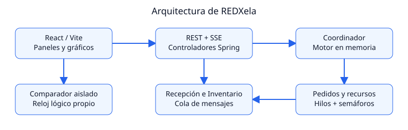
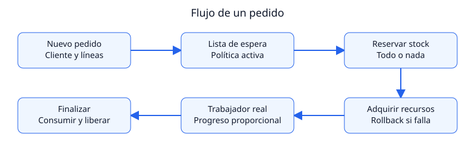
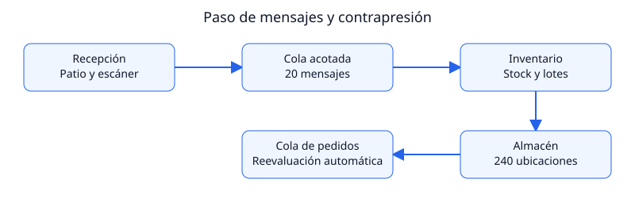
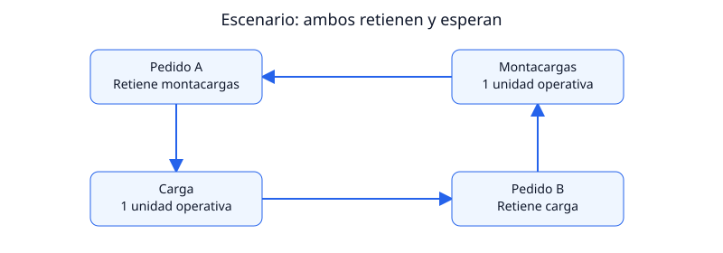

# REDXela — Manual Técnico

Proyecto Final de Sistemas Operativos 2 · USAC · Fase 8, 22 de octubre de 2026.

## 1. Arquitectura e infraestructura

El sistema representa un centro de distribución como procesos que compiten por recursos renovables y stock no renovable. Java 21 ejecuta la concurrencia real; Spring Boot 3.3.4 ofrece inyección de dependencias, REST y SSE. React 18, TypeScript, Vite y Recharts representan las fotografías del servidor. No hay base de datos, broker externo ni servicios de nube.

En desarrollo se ejecutan dos procesos: backend Java en 8080 y servidor Vite en 5173. Vite actúa como proxy de `/api`; el navegador no accede a estructuras internas Java. Maven compila y ejecuta JUnit; npm instala las versiones del lockfile y compila el frontend. El build del frontend es estático, pero este repositorio no incluye un despliegue de producción servido desde Spring.



El coordinador arranca Despachador, Recepción, Inventario y Detector. El generador se inicia por comando. El controlador publica SSE cada 500 ms con un ejecutor dedicado y conserva emisores activos. El comparador tiene un ejecutor independiente y motores que no reciben componentes de la sesión viva.

### 1.1 Inventario de hilos y sincronización

| Componente | Hilo y espera principal | Estado protegido |
|---|---|---|
| Despachador | hilo-despachador, Condition con reevaluación a 250 ms | Señal de trabajo; cola separada con lock |
| TrabajadorPedido | pedido-PED-*, uno por pedido activo | Recursos retenidos y progreso del pedido |
| Recepción | hilo-recepcion, Condition de patio y put de cola | Patio y asignación del escáner |
| Inventario | hilo-inventario, take de cola | Stock, reservas y lotes bajo lockStock |
| Generador | hilo-generador-pedidos, espera temporal y monitor | Admisión, RNG y cambio de semilla |
| Detector | hilo-detector-deadlock, intervalo de 500 ms | Último informe publicado mediante volatile |
| Publicador SSE | hilo-publicador-sse, tarea periódica | Lista de emisores CopyOnWriteArrayList |
| Comparador | hilo-comparacion-politicas y comparador-*, independientes | Estado del trabajo y reloj lógico con Condition |

Los pedidos de la sesión utilizan hilos de plataforma, no un pool fijo: permite asociar un pedido y su bloqueo a un hilo con nombre. La prevención limita la concurrencia por los recursos concedidos. Desactivar prevención puede aumentar los hilos bloqueados, de modo que ese modo se reserva para demostración controlada.

### 1.2 Organización del código

`modelo` contiene cuentas, catálogo y pedidos. `recursos` implementa pools y concesiones. `planificacion` contiene estrategias, cola y despachador. `proceso` contiene trabajadores y coordinación Spring. `recepcion`, `inventario` y `almacen` implementan suministro y asignación física. `deadlock` detecta y recupera. `estadisticas` y `eventos` agregan observaciones. `api` define rutas y DTOs; `excepciones` proporciona errores de dominio y traducción HTTP. `comparacion` contiene el experimento independiente. React separa transporte, tipos y componentes de panel.

## 2. Modelo y decisiones de dominio

Los 18 productos pertenecen a seis tipos con combinaciones distintas de recursos. Cada pedido solicita una unidad de cada tipo de recurso de la unión de sus líneas; repetir un recurso entre productos no aumenta su cantidad. Repetir un producto sí acumula sus unidades de stock antes de reservar.

| Mercancía | Combinación requerida | Ejemplos del catálogo |
|---|---|---|
| Frágil | Encargado + calidad + empaque | Jarrón, copas, espejo |
| Pesado | Encargado + montacargas + carga | Refrigeradora, lavadora, generador |
| Electrónico | Calidad + escáner + carga | Smartphone, laptop, servidor |
| Perecedero | Encargado + montacargas + calidad | Vacunas, salmón, frutas |
| Voluminoso | Montacargas + empaque + carga | Sofá, colchón, mesa |
| General | Encargado + empaque + carga | Libros, ropa, calzado |

Las capacidades son 10 encargados, 6 empaques, 2 cargas, 3 montacargas, 4 calidades y 1 escáner, total 26. El escáner es el mismo recurso en Recepción y en pedidos electrónicos. No existe un segundo escáner de despacho.

El nivel 1–5 establece objetivos de espera de 0, 10, 30, 60 y 120 minutos. El tipo decide recursos y el nivel decide prioridad. Los pedidos manuales heredan el nivel del cliente por defecto; la API conserva una sobrescritura explícita para experimentos avanzados. El generador elige el nivel ponderado y después una cuenta de ese nivel. El escenario de deadlock utiliza pedidos Exprés de demostración.

`Pedido` valida líneas y suma sin desbordamiento, calcula duración como unidades × 30 segundos, vencimiento de SLA y unión de recursos. Los IDs vivos usan un AtomicLong; el comparador usa IDs locales. Un orden personalizado tiene que ser una permutación exacta de la unión para evitar adquirir de menos, de más o solicitar dos veces un recurso exclusivo.

### 2.1 Reloj simulado

`SimClock` calcula tiempo transcurrido a partir de `System.nanoTime`, convertido a milisegundos; no usa una fecha de calendario. Un ReentrantLock permite cambiar factor y pausa sin saltos. El factor se acota entre 1 y 600, con rechazo de NaN e infinito; el predeterminado es 60.

Las esperas consultan el reloj simulado en segmentos de hasta 100 ms reales, para que la pausa y el cambio de velocidad afecten también a los trabajadores en curso. El progreso se actualiza por ticks del trabajador, aproximadamente veinte pasos por pedido. No es una medición de trabajo físico real ni una promesa de precisión de tiempo real duro.

## 3. Recursos, despacho y planificación

`PoolRecurso` combina un Semaphore justo con un lock de unidades para representar dueño, mantenimiento e instante de asignación. La justicia se aplica a esperas bloqueantes; los intentos inmediatos tryAcquire pueden adelantarse a una cola. Por eso no se afirma equidad global solamente por usar un semáforo justo.

`GestorRecursos.intentarAdquirirTodoONada` serializa el intento sobre la unión de recursos. Si falla un pool, devuelve todos los permisos ya obtenidos. El pedido no conserva recursos mientras espera: se niega retención y espera, una condición de Coffman. La alternativa de orden global también impediría espera circular, pero aquí se eligió todo-o-nada para admitir o dejar en cola sin retención parcial.

`Concesion` reúne las asignaciones y usa un AtomicBoolean para liberar una sola vez, en orden inverso. El trabajador libera siempre en finally y sólo después invoca su callback. Una interrupción por recuperación marca el pedido para reencolado; otro fallo cancela y se registra. El despachador consume o cancela la reserva según el resultado y despierta su monitor.



La cola usa un lock propio. El despachador toma candidatos ordenados, reserva todo el stock y después intenta recursos. Si falla stock, queda EN_ESPERA_STOCK; si fallan recursos revierte la reserva y queda EN_ESPERA_RECURSOS. Si ambos pasos son factibles lanza el hilo. Es conservador del trabajo: puede saltar a un candidato no factible. Esto aprovecha recursos, aunque puede postergar pedidos con combinaciones escasas.

En modo sin prevención el trabajador adquiere uno a uno con semáforos bloqueantes e interrumpibles. Puede retener varios recursos esperando el siguiente. No se hace expropiación de pedidos ya en proceso al llegar uno Exprés.

### 3.1 Estrategias disponibles

Prioridad estricta compara nivel, llegada e ID. Aging usa `max(1, nivel - floor(espera/600))`, desempata por llegada e ID y reduce postergación por prioridad; no crea stock ni garantiza progreso con recursos permanentemente indisponibles. SJF compara unidades, nivel, llegada e ID y puede postergar pedidos grandes. EDF compara vencimiento absoluto, nivel, llegada e ID.

Las garantías clásicas de SJF o EDF tienen supuestos que este centro no satisface en general. SJF y EDF tampoco fuerzan siempre Exprés al frente: ese comportamiento forma parte del criterio de cada estrategia, está documentado y se mide mediante el comparador. El cambio en caliente afecta candidatos futuros y despierta al despachador.

## 4. Recepción, inventario y almacenamiento



Recepción admite un Camion en el patio y retorna sin esperar descarga. Su hilo utiliza el escáner, lo libera en finally y construye un MensajeRecepcion inmutable. Envía mediante put a una ArrayBlockingQueue de capacidad 20. Inventario hace take, procesa y actualiza únicamente sus propias estructuras: las áreas se comunican por mensajes.

Escaneo requiere 200 ms simulados y consumo de mensaje 1000 ms simulados. Esta diferencia permite observar contrapresión bajo suficientes llegadas. Una cola llena bloquea al productor, pero el consumidor no necesita un recurso que Recepción retenga durante put: el escáner ya fue liberado. Bajo operación normal y consumidor activo la cola puede drenar; no se promete conservar datos después de cerrar un proceso cuya memoria se descarta.

### 4.1 Reserva sin sobreventa

El lockStock serializa comprobación y reserva de todas las líneas. Primero agrupa cantidades repetidas por producto y comprueba disponibilidad; después incrementa reservas. No hay modificación parcial si falta un producto. Al completar consume físico y reserva; al retroceder cancela reserva.

Invariante: `disponible = físico - reservado >= 0` bajo las operaciones del motor. Es un protocolo local de reserva y compromiso, no una implementación de transacciones distribuidas de dos fases. AtomicInteger facilita las consultas, pero el lock es lo que mantiene la atomicidad entre múltiples productos.

### 4.2 Asignación indexada

El almacén tiene 6 × 4 × 10 = 240 ubicaciones. BitSet usa 1 para libre y 0 para ocupado. First-fit elige las primeras ubicaciones disponibles sin exigir continuidad. El lote guarda una tabla de referencias a ubicaciones; es análogo a una tabla indexada de bloques de archivo, sin implementar todas las estructuras de un sistema de archivos real.

Un ReentrantReadWriteLock justo protege asignación, liberación, cambios parciales y snapshots. Cada celda almacena un producto de un lote. La capacidad depende del producto. Se admiten ubicaciones no contiguas y se evita exigir un segmento continuo; queda fragmentación interna en celdas parcialmente usadas.

Los snapshots de lote sólo incluyen celdas cuyo lote actual coincide. Al liberar la última, se retira el lote agotado. Esto evita consumir por error una ubicación reutilizada. Los lotes que no caben se conservan pendientes y se reintentan tras liberaciones; un lote mayor que toda la capacidad exige dividir la entrega, no se fragmenta automáticamente entre recepciones.

## 5. Detección, escenario y recuperación

`DetectorDeadlock` ejecuta cada 500 ms el algoritmo matricial para múltiples instancias. V contiene disponibles, A la asignación por proceso y S la solicitud actual. Se inicializa W=V y se marcan como terminados los que no retienen recursos. Mientras un proceso no marcado tenga S <= W, se supone que puede completar y se suma su fila A a W. Los restantes con solicitud pendiente forman el informe. Complejidad aproximada O(m × n²).

### 5.1 Ejemplo numérico

Con sólo un montacargas y una carga operativos:

| Proceso | A: montacargas, carga | S: montacargas, carga |
|---|---|---|
| A | 1, 0 | 0, 1 |
| B | 0, 1 | 1, 0 |

V=(0,0) y W=(0,0). Ninguna solicitud es menor o igual a W: ninguno puede marcarse. Existe bloqueo real en semáforos; el grafo es una explicación visual, no el criterio exclusivo del detector.



El escenario exige cola y trabajadores vacíos, stock preparado por el controlador y generador pausado. Aísla MTC-02, MTC-03 y CRG-02 en mantenimiento. Si una unidad no se puede aislar, revierte el mantenimiento nuevo antes de fallar. Dos pedidos cruzados se coordinan con CyclicBarrier después de su primera adquisición: ninguno intenta el segundo recurso antes de que ambos retengan el primero. Las pausas de 1,5 s facilitan la observación, pero la coordinación no depende de que los hilos se ejecuten casi al mismo tiempo.

Coffman: exclusión mutua por unidad; retención y espera entre adquisiciones; ausencia de expropiación automática; espera circular cruzada. El usuario elige ganador. El sistema activa prevención para futuros reintentos e interrumpe las víctimas, que liberan en finally y se reencolan. Así se evita que un reintento vuelva a construir el mismo ciclo. El botón Restaurar recursos retira mantenimiento una vez desaparece el conflicto.

Los snapshots por componente no constituyen una transacción global. Con carga arbitraria durante una transición, detector y telemetría pueden observar instantes próximos distintos; el escenario se aísla para que el estado de bloqueo sea estable y defendible. No se presenta el diagnóstico de una transición breve como una prueba matemática de un estado global congelado.

## 6. API, publicación, errores y configuración

Los controladores sólo validan, traducen DTOs y llaman al motor; no sustituyen sus semáforos por lógica HTTP. La respuesta JSON de un error incluye timestamp, status, error y mensaje. ClienteNoEncontradoException se traduce a 404, PedidoInvalidoException a 400 y ConflictoNoExisteException a 409 mediante sus tipos base. Los faltantes normales de stock o recursos son decisiones booleanas de planificación, no excepciones ni fallos del servidor.

Se rechazan datos inválidos con 400, entidades inexistentes con 404 y estado incompatible con 409. JSON mal formado produce 400; método incorrecto 405 y tipo de contenido no admitido 415. Un error inesperado registra traza y devuelve 500 con mensaje general, sin ocultarlo en silencio ni exponer detalles internos al navegador.

### 6.1 Rutas

| Método y ruta | Uso |
|---|---|
| GET /api/estado | Foto puntual |
| GET /api/estado/stream | SSE, evento estado |
| GET /api/catalogo | Productos y combinaciones de mercancía |
| GET y POST /api/clientes | Listar y registrar cuentas |
| POST /api/pedidos | Registrar pedido con líneas |
| POST /api/recepcion | Producto del catálogo y cantidad |
| POST /api/generador/iniciar, /pausar, /reanudar, /detener | Ciclo de creación automática |
| PUT /api/generador/config | Tasa y semilla |
| GET /api/politicas y PUT /api/politica | Catálogo y selección de estrategia |
| PUT /api/simulacion/velocidad | Factor y pausa del reloj |
| PUT /api/prevencion | Modo; activar también retira mantenimiento |
| POST /api/escenarios/deadlock | Demostración controlada |
| GET /api/conflicto y POST /api/conflicto/resolver | Informe y ganadorId |
| POST y GET /api/comparacion | Admitir y consultar experimento aislado |

No existe autenticación, autorización por usuario ni persistencia. El uso previsto es local y académico, no un servicio de Internet listo para producción.

### 6.2 Estado y fallos de conexión

EstadoSistema contiene reloj, controles, recursos, pedidos, almacén, recepción, inventario, estadísticas, conflicto y eventos. Cada componente toma su fotografía bajo su sincronización; las colecciones publicadas se copian para evitar modificación desde un consumidor. ClienteDTO expone nivel numérico, nombre y objetivo sin depender de cómo Jackson represente un enum.

El publicador SSE mantiene una tarea periódica con captura de excepciones para que un fallo no cancele todas las publicaciones futuras. Emisores y ejecutor se cierran al apagar. React usa EventSource con reconexión y sondeo de respaldo de 1,5 s. Cancela temporizadores y solicitudes al desmontarse. HTTP fallido y JSON inválido son errores visibles, incluso si un proxy devuelve HTML.

La configuración central define capacidades, dimensiones, factor, tiempos, cola, aging y ventanas históricas. Quedan 200 completados vivos, 100 eventos y 100 muestras de cola; se agregan los contadores del resto. La cola de pedidos pendientes y patio no tienen un límite de admisión: una sesión con llegadas sostenidas sin abastecimiento puede agotar memoria. No se afirma memoria constante para esa carga.

## 7. Comparación experimental de políticas

### Objetivo y alcance

`SimuladorComparativo` mide prioridad estricta, prioridad con aging, menor cantidad primero (SJF) y EDF con la misma carga finita. Cada política recibe pedidos nuevos, su propio `GestorRecursos`, `ListaEspera`, `Estadisticas` y reloj. Reutiliza las implementaciones de las políticas y `TrabajadorPedido` del sistema en vivo, sin tomar componentes de Spring ni recursos del almacén operativo.

El experimento mantiene prevención todo-o-nada y stock suficiente: mide planificación y contención de recursos, sin introducir faltantes de mercancía, recepción o conflictos provocados. No predice directamente el comportamiento de una operación con desabastecimiento.

### Carga y reproducibilidad

La configuración predeterminada es semilla **42**, **300 pedidos**, **4 llegadas por minuto simulado**. Se permiten 1–1000 pedidos y tasas entre 0,1 y 120. Un `Random` local y el catálogo ordenado por ID generan:

- Intervalos exponenciales `−ln(1−U) × 60/tasa`, acumulados antes de cuantizar a segundos. Varias llegadas pueden coincidir en el mismo segundo.
- Niveles con mezcla aproximada 5/15/30/30/20 %. Los primeros cinco pedidos cubren los niveles 1–5 cuando la carga tiene al menos cinco pedidos.
- 1–4 productos distintos por pedido y 1–40 unidades por línea.

Los IDs locales `CMP-000001`… no consumen ni reinician el secuencial global de pedidos. Una huella SHA-256 identifica la secuencia completa de llegadas, niveles, productos y cantidades. Misma configuración y versión del generador deben producir la misma huella y los mismos resultados completos.

### Hilos reales y tiempo lógico

Acelerar únicamente `Thread.sleep` seguiría dejando las medidas sujetas al planificador del sistema operativo. Por eso el comparador usa `RelojComparativo`:

1. Incorpora todas las llegadas del instante actual.
2. Ordena candidatos mediante la política real e intenta adquirir sus recursos reales con semáforos y rollback.
3. Cada pedido admitido ejecuta un `TrabajadorPedido` en su propio hilo de plataforma, reteniendo su `Concesion` hasta terminar.
4. Los trabajadores esperan en una `Condition` por sus plazos de tiempo lógico. El conductor espera también en una condición hasta que todos estén dormidos o hayan finalizado.
5. El reloj salta a la próxima llegada o finalización. Las finalizaciones de ese instante liberan sus recursos y registran estadísticas antes de la siguiente evaluación de la cola.

Cada trabajador acumula sus ticks propios, incluso si el reloj salta varios ticks: no se pierde duración ni se introduce retraso por despertar tarde en tiempo real. El número de trabajadores activos está limitado por los recursos disponibles. Al terminar o interrumpirse la corrida se liberan concesiones, se interrumpen trabajadores restantes y se espera su cierre. Un plazo de diez segundos reales para alcanzar reposo detecta fallos; no participa en las métricas.

El conductor reproduce la evaluación conservadora del trabajo: salta candidatos no factibles. Con stock suficiente y recursos de capacidades constantes, los puntos relevantes para volver a asignar son las llegadas y liberaciones; aging se recalcula en cada evaluación. La interfaz en vivo mantiene su despachador y su reloj originales.

### Métricas y fórmulas

Para el pedido `i`, `esperaᵢ = inicioᵢ − llegadaᵢ`. La duración de trabajo sigue siendo unidades × 30 segundos simulados. Se reportan media y máximo de espera, media por nivel y SLA global y por nivel.

- Cumplimiento de SLA: `esperaᵢ ≤ objetivo(nivelᵢ)`.
- Indicador de espera excesiva denominado «inanición» en el plan: `esperaᵢ > 2 × objetivo(nivelᵢ)`. Para Exprés, cuyo objetivo es cero, toda espera positiva cuenta. Una corrida finita no demuestra inanición indefinida.
- Horizonte `T`: última finalización menos primera llegada; incluye intervalos ociosos.
- Throughput: `pedidos completados × 60 / T`.
- Ocupación de un recurso `r`: `100 × Σ duración de pedidos que retienen r / (capacidadᵣ × T)`.
- Ocupación media: suma de segundos-unidad ocupados dividida entre `26 × T`, en porcentaje; es ponderada por unidades, no el promedio simple de seis porcentajes.

La ocupación es acumulada sobre la corrida, a diferencia de la fotografía instantánea del panel de operaciones. Si un nivel no tiene muestras, la tabla lo indica y la gráfica omite su barra.

### Resultados reproducibles de referencia

Configuración 42 / 300 / 4, ejecutada sin Spring el 21/10/2026:

`57015b22436e54fbf00ca3f3274ccd8f7c6d7983fec90bbd92f751c5d7701844`

| Política | Espera media (s) | Espera máxima (s) | SLA (%) | Pedidos/min sim | Ocupación media (%) | Espera > 2× SLA | Horizonte (s) |
|---|---:|---:|---:|---:|---:|---:|---:|
| Prioridad estricta | 100354,99 | 217467 | 6,33 | 0,080340 | 39,38 | 276 | 224048 |
| Prioridad con aging | 97557,11 | 219695 | 7,67 | 0,079132 | 38,79 | 265 | 227468 |
| SJF | 69910,13 | 224699 | 17,33 | 0,078064 | 38,26 | 238 | 230580 |
| EDF | 100040,43 | 217475 | 5,67 | 0,080343 | 39,38 | 277 | 224040 |

Espera media por nivel, en segundos:

| Política | Exprés | Prioritario | Estándar | Programado | Económico |
|---|---:|---:|---:|---:|---:|
| Prioridad estricta | 3745,13 | 15001,61 | 56108,90 | 121180,24 | 186988,94 |
| Prioridad con aging | 96096,67 | 99135,21 | 102635,01 | 95927,57 | 92788,82 |
| SJF | 64718,20 | 64279,07 | 74759,32 | 72182,95 | 63388,41 |
| EDF | 22389,13 | 32705,04 | 62396,58 | 108237,05 | 185044,20 |

**Conclusión:** esta carga satura ampliamente los recursos. SJF reduce la espera media y logra el mayor SLA global; bajo ese criterio es la recomendación de esta corrida, aunque presenta la mayor espera máxima. Prioridad estricta protege mejor a Exprés y concentra las demoras en los niveles bajos. Aging reduce la espera media de Económico de 186988,94 a 92788,82 segundos, a costa de esperar más en niveles altos; ninguna política corrige por sí sola la sobrecarga ofrecida. EDF no gana en SLA en esta muestra: este sistema no expropiativo y con múltiples recursos no cumple los supuestos que permitirían afirmar optimalidad general.

Para elegir una política operativa hay que fijar primero el objetivo (SLA global, Exprés, equidad o espera media) y repetir el experimento con distintas semillas y tasas. La pantalla genera una conclusión de cada corrida, con criterio SLA y desempate por espera media; en empate total conserva el orden de políticas. No presenta esta muestra como una recomendación universal de producción.

### API y ciclo de vida

`POST /api/comparacion` admite una configuración opcional y devuelve **202** con `id` y estado `EJECUTANDO`. Campos omitidos usan valores predeterminados:

```json
{"semilla":42,"cantidadPedidos":300,"tasaLlegadasPorMinuto":4}
```

`GET /api/comparacion` devuelve `SIN_EJECUTAR`, `EJECUTANDO`, `COMPLETADA` o `ERROR`. Al completar incluye configuración, huella, alcance, cuatro resultados y conclusión. El servicio conserva sólo el último trabajo y rechaza otro concurrente con **409**; datos fuera de rango producen **400**. Al cerrar Spring interrumpe el ejecutor y sus trabajadores liberan sus recursos. No se almacena historial persistente.

El panel consulta cada 500 ms mientras hay trabajo. Al desmontarse cancela consultas y temporizadores; el trabajo del backend continúa, y volver a la pestaña recupera su estado. Los errores incluyen reintento manual.

### Evidencia de verificación

La suite incluye resultados completos idénticos al repetir la configuración por defecto, cambios de huella con otra semilla, secuencial global intacto, cálculo manual de esperas y ocupación, procesamiento concurrente con capacidad limitada, liberación de hilos y rechazo de trabajos solapados. Pruebas HTTP verifican 202/GET, validaciones y que inventario, almacén, recursos, política, reloj, eventos y contador de creados en vivo no cambien por el experimento. El transporte React verifica envío de configuración y propagación de 409.

La inspección visual de la tabla, gráfica y navegación sigue pendiente en un navegador local debido a las restricciones del entorno del agente.

## 8. Mapa de conceptos del curso al código

| Concepto | Clase o método donde se observa |
|---|---|
| Hilo por proceso | TrabajadorPedido.run y Despachador.lanzarTrabajador |
| Semáforo contador / exclusión mutua | PoolRecurso.acquire, tryAcquire y release; ESCANER de capacidad 1 |
| Monitor y espera por evento | Despachador.despertar y su Condition |
| Planificación intercambiable | PoliticaAtencion.comparador y GestorPoliticas |
| Aging e inanición | PoliticaPrioridadConAging.calcularNivelEfectivo |
| Prevención de deadlock | GestorRecursos.intentarAdquirirTodoONada y rollback |
| Coffman, detección multi-instancia | DetectorDeadlock.ejecutarDeteccion |
| Recuperación por retroceso | GestorEscenarioDeadlock.resolverConflictoManual y catch de interrupción del trabajador |
| Barrera de sincronización | Pedido.esperarParDelEscenario y CyclicBarrier de dos participantes |
| Productor-consumidor | Recepcion.run, MensajeRecepcion e Inventario.run |
| Lectores-escritores | Almacen, ReentrantReadWriteLock y snapshot |
| Asignación indexada / bitmap | Lote, EntradaAsignacion, Almacen.intentarAsignarLote y BitSet |
| Atomicidad de stock | Inventario.intentarReservarStock bajo lockStock |
| Agregación concurrente | Estadisticas con LongAdder y AtomicLong |
| Tiempo lógico y experimento | RelojComparativo, MotorComparativo y SimuladorComparativo |
| Paso de valores hacia UI | EstadoSistema y transporte SSE / sondeo |

## 9. Decisiones de diseño y alternativas

El registro completo problema → alternativas → elección → fundamento se mantiene en `docs/bitacora_decisiones.md`. Estas decisiones sintetizan las que afectan la defensa:

| Problema | Alternativas | Elección y fundamento |
|---|---|---|
| Representar cada pedido | Bucle secuencial, pool fijo, hilo propio | Hilo de plataforma propio para mostrar adquisición, bloqueo y liberación reales |
| Recursos de varias unidades | Contador sin protección, locks manuales, Semaphore | Semáforo contador más dueños bajo lock; permisos reflejan capacidad |
| Prevenir interbloqueo | Orden global o todo-o-nada | Todo-o-nada niega retención y espera; rollback no deja permisos parciales |
| Despertar cola | Busy-wait o monitor | Condition ante llegada de stock, pedido o liberación; timeout sólo para reevaluar tiempo |
| Distribuir espacio | Contiguo, encadenado o indexado | Tabla por lote y bitmap, sin exigir continuidad física |
| Comunicar áreas | Estado compartido o mensajes | Cola acotada e inmutable; productor espera sin retener escáner |
| Evitar sobreventa | Comprobar sin lock o reservar conjunto | Verificación y reserva bajo el mismo lock de inventario |
| Visualizar en vivo | Sondeo continuo, WebSocket o SSE | Flujo unidireccional SSE de fotos y sondeo sólo como respaldo |
| Medir políticas | Corridas de pared o reloj lógico | Reloj lógico con trabajadores reales e instancias separadas |
| Garantizar escena cruzada | Pausas probables o barrera | Barrera después de primera adquisición; ambos pedidos retienen antes de seguir |
| Recuperar sin repetir ciclo | Reintento incremental o prevención | Elegir ganador e interrumpir víctima, activar todo-o-nada para reintentar |
| Gestionar faltantes normales | Excepciones por cada espera o estados | Stock/recurso ausente queda en cola; excepciones semánticas sólo para entradas o comandos inválidos |

Estas elecciones priorizan una implementación explicable en el curso. No se agregaron una base de datos, un framework de concurrencia adicional ni excepciones vacías para caminos donde el resultado normal es «todavía no hay recursos».

## 10. Pruebas, construcción y evidencia

Desde `backend`, ejecutar `mvn test`; desde `frontend`, `npm test` y `npm run build`. Para producir el JAR, `mvn package`; se genera `backend/target/redxela-1.0.0.jar`, ejecutable con `java -jar`. El frontend se compila en `frontend/dist` y necesita una ruta `/api` hacia el backend cuando se sirve fuera de Vite.

En el entorno del agente, `mvn package` compiló y ejecutó las 45 pruebas antes de detenerse en el plugin de empaquetado: falta `org.apache.maven.shared:file-management:3.1.0` y `~/.m2` es de sólo lectura. No se generó el JAR. El empaquetado debe completarse en Fase 9 con una caché escribible y las dependencias disponibles; no se cambió el pom para ocultar esa limitación.

La suite tras la revisión incluye 45 ejecuciones de prueba Java, sin fallos ni omisiones, y 7 pruebas de transporte TypeScript ejecutadas con Node. Las clases por fase permiten ubicar la evidencia:

| Suite | Qué comprueba |
|---|---|
| Fase1ModeloTest | Niveles, catálogo, unión de recursos y reloj |
| Fase2ConcurrenciaTest | Capacidad de pools bajo hilos concurrentes y rollback |
| Fase3PoliticasYEstadisticasTest | Orden de políticas, aging y agregación |
| Fase4AlmacenEInventarioTest | No contigüidad, bitmap, contrapresión sin pérdida, reserva y despertar por stock |
| Fase5DeadlockTest | Detección de bloqueo y recuperación con finalización |
| Fase6ApiTest | REST, SSE inicial, errores, flujo de pedidos/recepción, pausa, lotes y contadores |
| Fase7ComparadorTest | Determinismo completo, tiempos manuales, recursos simultáneos y cierre |
| Fase7ComparacionApiTest | Admisión asíncrona y aislamiento respecto al sistema vivo |
| Fase8CalidadTest | Nivel heredado, productos repetibles, snapshots inmutables, pausa de llegadas y elección de ambos ganadores |
| frontend/tests/api.test.cjs | HTTP fallido, SSE/sondeo, cancelación, comparación y respuestas HTML/JSON inválidas |

Mockito usa mock-maker-subclass porque las pruebas no necesitan mockear clases finales ni auto-adjuntar agentes a la JVM. MockMvc prueba controladores con el motor real sin abrir puertos, lo que permite verificar la integración HTTP en el entorno restringido. No sustituye una prueba visual del navegador.

## 11. Limitaciones y mejoras identificadas

La entrega académica conserva estado únicamente en memoria. Una cola sostenida sin stock crece; no hay almacenamiento de cola en disco ni control de admisión global. Al apagar se descarta la sesión. La ventana de completados, eventos y muestras sí está acotada.

La API no expone todavía cancelación manual de pedidos ni un reinicio de sesión sin reiniciar el backend. Un lote se admite completo o espera espacio; una entrega mayor que toda la capacidad debe dividirse. La selección ponderada del generador no garantiza exactamente la proporción de cada nivel en una ventana pequeña.

El detector toma snapshots parciales y la UI tiene latencia de publicación; no se promete una fotografía global atómica. La prevención activa evita los ciclos del modo incremental, pero puede existir espera por stock o recursos. Los tiempos del sistema vivo son simulados sobre hilos del SO y no son mediciones exactas de rendimiento de hardware.

La operación en modo sin prevención puede crear muchos hilos en espera. Debe reservarse para la demostración dirigida. El comparador controla la carga finita y no produce faltantes de stock: sus resultados no describen automáticamente una operación con desabastecimiento.

El build de Vite conserva una advertencia por tamaño del paquete JavaScript; no es un error de compilación. Las capturas de sesión real, revisión en proyector y dos recorridos visuales completos quedan para Fase 9, sin marcarse como realizados desde el entorno del agente.

## 12. Respuestas para defensa

### 12.1 ¿Por qué un hilo por pedido y no un pool fijo?

Un hilo permite observar al pedido bloqueado en el semáforo y seguirlo por nombre. En prevención sólo se lanzan pedidos cuyos recursos ya están concedidos. Un pool fijo puede reducir creación de hilos y limitar concurrencia, pero exige explicar cómo evitar que hilos ocupados esperando recursos impidan ejecutar trabajo útil. En producción convendría acotar admisión y medir esa alternativa.

### 12.2 ¿Qué condiciones de Coffman aparecen y cuál se niega?

En la escena hay exclusión mutua por unidad, retención de un recurso mientras se pide otro, ausencia de expropiación automática y ciclo A→carga→B→montacargas→A. Todo-o-nada niega retención y espera. La interrupción de víctimas es recuperación explícita, no el modo preventivo de adquisición.

### 12.3 ¿Semáforo o lock para el escáner?

El pool del escáner usa Semaphore de un permiso, equivalente en exclusión a un recurso binario bajo un protocolo correcto. Un ReentrantLock tiene propiedad de hilo y condiciones; el semáforo administra permisos y el modelo registra dueño de forma explícita. El lock del pool protege los metadatos, no sustituye la capacidad del recurso.

### 12.4 ¿Por qué ArrayBlockingQueue y qué ocurre al llenarse?

Su capacidad 20 hace visible el búfer acotado. put bloquea al productor y take bloquea al consumidor vacío. Una cola no acotada ocultaría la presión y permitiría acumular memoria; acotar esta cola no acota por sí solo el patio ni los pedidos pendientes.

### 12.5 ¿Por qué no se pierden mensajes ni se forma espera circular entre áreas?

La recepción normal envía con put, sin descartar por cola llena. Libera el escáner antes de enviar, por lo que el consumidor no espera un recurso que el productor conserve al bloquearse. Esto supone hilos activos, mensajes válidos y operación normal; no equivale a persistencia frente a apagado o fallo del proceso.

### 12.6 ¿Qué es inanición y cómo ayuda aging?

Es la postergación indefinida de un pedido mientras otros continúan. Con prioridad estricta, nuevas llegadas superiores pueden relegar nivel 5. Aging aumenta prioridad con el tiempo y desempata por antigüedad. No puede reparar falta permanente de stock o capacidad; el indicador del comparador mide espera excesiva en una carga finita.

### 12.7 ¿Cuándo es óptimo SJF y cuál es su riesgo?

En el caso ideal de un procesador y trabajos conocidos disponibles al inicio, ordenarlos por duración minimiza espera media. Aquí las unidades estiman duración, pero hay llegadas y varios recursos: la garantía ideal no se traslada automáticamente. Puede postergar pedidos grandes.

### 12.8 ¿Cómo se calcula aging?

Cada 600 segundos simulados de espera se resta uno al nivel, con mínimo 1. Un nivel 5 que esperó 1800 segundos tiene nivel efectivo 2. No se cambia el nivel contratado del cliente: sólo la prioridad efectiva de comparación.

### 12.9 ¿Cómo funciona el detector con números?

Con A asignado (1,0), B asignado (0,1), solicitudes opuestas (0,1) y (1,0), y disponibles (0,0), W no satisface ninguna solicitud y ambos quedan sin marcar. Si hubiera otra carga disponible, podría marcarse A, sumar su montacargas y después marcar B: un ciclo dibujado no basta cuando hay múltiples instancias.

### 12.10 ¿Qué pasa con la víctima?

Se interrumpe su hilo bloqueado. El catch registra retroceso y el finally cierra su concesión; el callback cancela la reserva y reencola. La prevención se activa antes de interrumpir para que el reintento no repita adquisición parcial cruzada. El ganador puede adquirir el recurso liberado y completar.

### 12.11 ¿Por qué asignación no contigua y bitmap?

El mapa indica ubicaciones libres y el lote conserva su tabla indexada. Un lote puede tomar celdas 0,1,2,4 aunque 3 esté ocupada. Es una analogía de bloques indexados de archivo o marcos de páginas: no exige continuidad, pero puede dejar espacio interno sin utilizar.

### 12.12 ¿Cómo se evita vender dos veces la misma existencia?

No se separa comprobación y reserva. lockStock agrupa cantidades por producto, verifica todas y reserva bajo la misma exclusión. Dos trabajadores que terminan o un consumidor que incorpora stock también coordinan cambios con ese lock. El semáforo de empaque no protege por sí solo el stock.

### 12.13 ¿Dónde habría una carrera sin los locks?

Dos admisiones podrían leer la misma disponibilidad y reservar ambas; dos asignaciones del almacén podrían tomar el mismo bit libre; la foto de una unidad podría mezclar dueño y estado. Locks y permisos protegen invariantes diferentes. volatile hace visible un campo, pero no vuelve atómica una operación con varios productos.

### 12.14 ¿Para qué sirven los dos relojes?

El vivo permite observar objetivos de hasta 120 minutos acelerados a una escala de defensa. Su origen monotónico evita retroceso por ajustes del reloj del sistema. El lógico del comparador elimina variación del planificador del SO y hace repetibles tiempos de llegada y finalización, conservando hilos y semáforos reales.

### 12.15 ¿Qué política se recomienda y con qué evidencia?

Para la carga 42/300/4, SJF mejora espera media y SLA global; prioridad estricta protege mejor a Exprés y aging reparte más la demora hacia niveles altos. Se elige primero el objetivo y se repite con otras cargas. No se declara una política universalmente mejor ni se atribuye a EDF una garantía de SLA que no corresponde al modelo.
