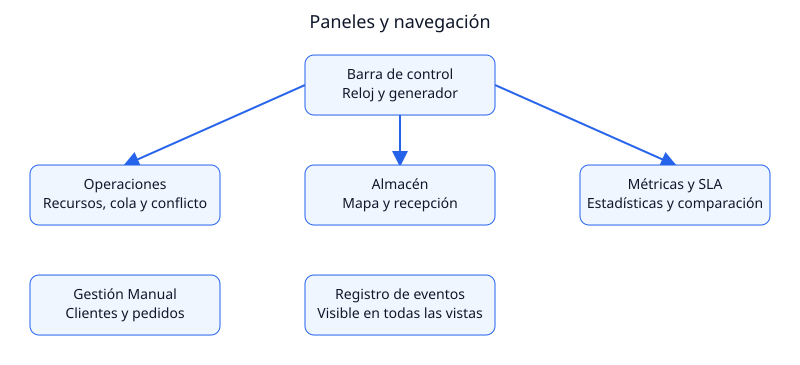

# REDXela — Manual de Usuario

Proyecto Final de Sistemas Operativos 2 · USAC · Versión de documentación: Fase 8, 22 de octubre de 2026.

## 1. Propósito

REDXela permite observar cómo un centro de distribución comparte recursos entre pedidos concurrentes. El usuario registra clientes, pedidos y mercancía, cambia la política de atención, observa el almacén y puede provocar y resolver un interbloqueo. Cada pedido activo trabaja en un hilo Java real.

La aplicación es un simulador académico local. Los datos permanecen en memoria: detener el backend elimina clientes agregados, pedidos, inventario y resultados. No hay inicio de sesión ni contraseñas; crear una cuenta significa registrar al cliente y su nivel de servicio.

## 2. Requisitos y arranque

Se requieren Java 21, Maven 3.9+, Node.js 22 y npm, y un navegador moderno con JavaScript y Server-Sent Events. Instalar estas herramientas corresponde al usuario; el proyecto no las instala globalmente.

Abrir dos terminales desde la carpeta `Proyecto_SOPES_2`.

Terminal del backend:

```bash
cd backend
mvn test
mvn spring-boot:run
```

Terminal del frontend:

```bash
cd frontend
npm ci
npm run dev
```

Abrir `http://localhost:5173`. El backend escucha en `http://localhost:8080`; Vite redirige las solicitudes `/api` hacia ese servidor. Si se cambia el puerto del backend, se debe actualizar también `frontend/vite.config.ts`.

Al iniciar, entran dos ubicaciones de cada uno de los 18 productos por el flujo de recepción. Esperar unos segundos para que termine la carga inicial. El generador comienza apagado y la prevención de deadlock activada.

Para detener, pausar el generador y usar Ctrl+C en ambas terminales. Reiniciar el backend restaura la carga inicial y elimina los datos de la sesión anterior.

## 3. Organización de la pantalla

La barra de control y el registro de eventos están disponibles en todas las pestañas. Los once paneles del proyecto se distribuyen así:

| Ubicación | Paneles y finalidad |
|---|---|
| Barra superior | Política, velocidad, reloj, generador y prevención; botón de deadlock |
| Operaciones en Vivo | Recursos y sus dueños, pedidos activos, lista de espera, conflicto y resolución |
| Almacén e Inventario | Mapa de ubicaciones y lotes; recepción, patio, cola y existencias |
| Métricas y SLA | Indicadores y gráficas en vivo; comparador de políticas |
| Gestión Manual | Registro de clientes y pedidos con varias líneas |
| Pie de pantalla | Últimos 100 eventos del servidor |



El indicador de conexión distingue telemetría SSE, sondeo de respaldo y reconexión. Con SSE se recibe una actualización aproximadamente cada 500 ms. Cuando falla el stream, el sondeo consulta cada 1,5 segundos. Si el backend no responde, los datos visibles pueden estar desactualizados.

## 4. Registrar clientes y pedidos

### 4.1 Crear una cuenta

Entrar a **Gestión Manual**, completar nombre y correo y seleccionar el nivel. Pulsar **Registrar Cliente**. La cuenta debe aparecer en el selector de pedidos.

| Nivel | Servicio | Objetivo de espera simulada |
|---|---|---:|
| 1 | Exprés | 0 minutos |
| 2 | Prioritario | 10 minutos |
| 3 | Estándar | 30 minutos |
| 4 | Programado | 60 minutos |
| 5 | Económico | 120 minutos |

Estos tiempos son objetivos de espera, no una garantía: un pedido puede esperar si no hay stock o si otro ya usa sus recursos. Un pedido en proceso no se interrumpe para dar paso a Exprés.

### 4.2 Crear un pedido

Seleccionar cliente y elegir producto y cantidad en cada línea. Usar **Agregar Producto** para varias líneas y el icono de papelera para quitarlas. Pulsar **Enviar a Despacho**. El pedido hereda el nivel contratado y aparece en la cola o en proceso según disponibilidad.

Para una primera prueba, elegir un cliente y una unidad de `PROD-GEN-01` (Caja de Libros Académicos). Con la carga inicial y prevención activa debería completar automáticamente. Revisar el registro de eventos.

La opción de orden personalizado de recursos es avanzada: dejarla vacía en el uso normal. Si se utiliza, debe contener cada recurso requerido exactamente una vez, separado por comas; por ejemplo, un producto pesado admite `MONTACARGAS, CARGA, ENCARGADO`. Un orden incompleto o repetido es rechazado.

### 4.3 Interpretar estados y progreso

| Estado | Significado y acción |
|---|---|
| EN_ESPERA_STOCK | Faltan unidades de algún producto; registrar mercancía en Recepción |
| EN_ESPERA_RECURSOS | El pedido tiene que esperar recursos compartidos |
| EN_PROCESO | Su hilo está realizando trabajo proporcional a las unidades |
| BLOQUEADO | Participa en el conflicto detectado; elegir ganador en el panel de deadlock |
| COMPLETADO | Finalizó y consumió su stock reservado |
| CANCELADO | Falló el procesamiento; revisar el registro del backend |

En proceso se muestran cliente, nivel, tipo de mercancía, porcentaje, tiempo restante estimado, recursos retenidos y recurso solicitado. Los tiempos se expresan en segundos simulados. La lista de espera muestra posición, criterio de la política, espera frente al objetivo y motivo de espera. El rojo indica que el objetivo de SLA ya se excedió.

## 5. Controles en vivo

**Velocidad:** 1×, 60×, 120×, 300× o 600×. A 60×, un segundo real representa un minuto simulado. Una unidad requiere 30 segundos simulados; diez unidades necesitan aproximadamente cinco segundos reales a 60× después de obtener recursos.

**Pausa del reloj:** detiene el avance de las esperas simuladas y del trabajo, y evita nuevas llegadas automáticas. Los comandos manuales siguen disponibles. Para detener únicamente la creación de pedidos, apagar el generador.

**Generador:** el botón ON/OFF inicia o pausa la creación automática. Su configuración permite cambiar la tasa media y una semilla opcional entera. Pulsar **Aplicar configuración**. Los intervalos son aleatorios, por lo que una tasa de seis pedidos por minuto no significa uno exactamente cada diez segundos. No hay tope acumulado de pedidos, pero cada sesión sigue limitada por la memoria de la máquina: si el stock se agota y la cola crece, pausar o reabastecer.

**Política:** se cambia en caliente y reordena a los pedidos pendientes. No modifica un pedido que ya está trabajando.

| Política | Criterio visible |
|---|---|
| Prioridad estricta | Nivel menor primero; desempate por llegada |
| Prioridad con aging | La espera aumenta la prioridad cada diez minutos simulados |
| Menor cantidad (SJF) | Menor número de unidades primero |
| EDF | Vencimiento del objetivo de espera más cercano |

La semilla del generador repite la selección aleatoria bajo las mismas condiciones, pero no fija los tiempos del sistema operativo. Para resultados completamente reproducibles se utiliza el comparador.

## 6. Recursos, recepción y almacén

Los recursos cuentan con 10 encargados, 6 estaciones de empaque, 2 áreas de carga, 3 montacargas, 4 estaciones de calidad y 1 escáner. Cada tarjeta identifica las unidades libres, ocupadas y en mantenimiento. Una unidad ocupada muestra el pedido o camión que la utiliza.

### 6.1 Recibir mercancía

Entrar a **Almacén e Inventario**. En Recepción, elegir un producto del catálogo y su cantidad, luego pulsar **Recibir Camión**. No se crean productos nuevos desde la interfaz.

El camión pasa por patio y escáner, y envía un mensaje a Inventario. Este último actualiza el stock, asigna ubicaciones y despierta pedidos que estaban esperando esas existencias. El proceso es automático; no es necesario volver a ingresar el pedido.

El panel muestra tamaño y capacidad de la cola de mensajes, camiones en patio, estado del escáner y lotes pendientes de espacio. Una cola llena ejerce contrapresión: Recepción espera antes de enviar otro mensaje. Esto es una espera de coordinación, no un deadlock. El consumidor es deliberadamente más lento para poder observar el fenómeno con suficientes camiones.

### 6.2 Consultar existencias y mapa

La tabla distingue existencias físicas, unidades reservadas para pedidos y unidades disponibles. Disponible equivale a físico menos reservado.

El almacén tiene 240 ubicaciones distribuidas en seis pasillos, cuatro niveles y diez posiciones. Seleccionar pasillo y una celda para consultar producto, cantidad, capacidad y lote. La tabla de lotes enumera sus ubicaciones actuales; un lote puede ocupar celdas separadas. Las celdas vacías se reutilizan automáticamente.

Si el almacén está lleno, los lotes nuevos esperan espacio. Completar pedidos libera ubicaciones y permite reintentar esos lotes. Un lote que excede por sí solo la capacidad física no podrá entrar completo: utilizar entregas más pequeñas. No hay eliminación manual de inventario ni compactación.

## 7. Provocar y resolver deadlock

Usar una sesión recién iniciada para la primera demostración. Esperar la carga inicial y mantener pausado el generador. No debe haber pedidos activos ni en espera. Debe existir stock de dos unidades de `PROD-PES-01` y una de `PROD-VOL-01`.

1. Pulsar **Provocar Deadlock**. El escenario desactiva prevención, deja un montacargas y un área de carga operativos y crea dos pedidos con orden cruzado.
2. Esperar aproximadamente tres segundos reales. Cada pedido retiene un recurso y espera el del otro; aparecerán alerta, explicación y grafo.
3. En el panel, elegir el pedido que debe continuar con el botón de ganador. No hace falta resolver desde la consola.
4. La víctima es interrumpida, libera sus recursos, vuelve a la cola y luego completa. El sistema activa prevención para sus reintentos y evita reconstruir el ciclo.
5. Cuando desaparezca el conflicto, pulsar **Restaurar recursos** en la barra para retirar también el mantenimiento. El botón aparece al quedar prevención activa y no existir conflicto.
6. Comprobar ambos pedidos completados en eventos y todas las unidades disponibles. Reabastecer los productos del escenario antes de repetir si ya no hay stock suficiente.


En el grafo, naranja representa recurso retenido hacia pedido y rojo representa pedido hacia recurso solicitado. Las flechas explican el conflicto; el detector utiliza un algoritmo de matrices, no solamente la existencia de un ciclo dibujado.

Si se solicita el escenario con pedidos pendientes, el sistema rechaza la acción con un mensaje. Pausar el generador, abastecer los productos faltantes y esperar la finalización; también puede reiniciarse el backend para una sesión nueva, perdiendo los datos de la actual.

## 8. Métricas y comparador

El panel en vivo presenta pedidos creados y completados, espera y procesamiento promedio, SLA, throughput y evolución de cola. La ocupación de recursos mostrada allí es instantánea; una unidad en mantenimiento se distingue del trabajo productivo.

Para comparar políticas, entrar a **Métricas y SLA**, elegir semilla, cantidad de 1 a 1000 y tasa de 0,1 a 120 llegadas por minuto, y pulsar **Comparar políticas**. La configuración inicial es 42 / 300 / 4. El experimento utiliza recursos independientes y no consume el inventario operativo.

Al completar se muestran cuatro filas con espera, SLA, throughput, ocupación acumulada, espera excesiva y horizonte. La gráfica cambia entre espera media y SLA por nivel; desplegar los detalles para valores por nivel y por recurso. La huella identifica la carga: repetir la configuración debe producir la misma huella y los mismos resultados.

Puede cambiarse de pestaña mientras se ejecuta. Volver recupera el resultado. Sólo se acepta una comparación a la vez; otra solicitud concurrente es rechazada. **Consultar estado** permite recuperar la consulta tras un error de conexión.

El comparador tiene stock suficiente y prevención activa para medir planificación. Su conclusión corresponde a esa carga, no a todas las operaciones posibles. «Espera > 2× SLA» es un indicador de demora excesiva; para Exprés, cuyo objetivo es cero, cualquier espera positiva cuenta. No prueba inanición infinita.

## 9. Problemas frecuentes

| Síntoma | Qué revisar |
|---|---|
| Reconectando / datos desactualizados | Backend en puerto 8080, consola de ambas terminales y proxy de Vite |
| Puerto ocupado | Detener la instancia anterior o cambiar backend y proxy de forma consistente |
| Pedido no inicia | Stock disponible y recursos; no confundir reservado con libre |
| No se puede provocar deadlock | Generador pausado, cola vacía, trabajadores terminados y productos del escenario abastecidos |
| Recursos grises tras resolver | Pulsar Restaurar recursos en la barra |
| Comparador rechaza otra ejecución | Consultar el trabajo existente y esperar que termine |
| Datos desaparecieron | Se reinició el backend; la persistencia es sólo en memoria |
| Fallo de compilación Java | Verificar que `java -version` y `mvn -v` utilizan Java 21 |
| Error JSON, cantidad, nivel u orden | Leer el mensaje del formulario y corregir los datos; no repetir ciegamente |

Un error interno se registra con traza en la terminal del backend. Conservar ese mensaje y la acción realizada para poder reproducir el problema.

## 10. Verificación visual y glosario

Las capturas de una sesión real y la comprobación en proyector siguen pendientes de Fase 9; este manual no presenta diagramas como si fueran capturas. La lista de imágenes a obtener está en `docs/capturas/README.md`. Los diagramas anteriores son ilustraciones del funcionamiento.

**SLA:** objetivo de espera según nivel. **Aging:** aumento de prioridad por tiempo en cola. **Stock reservado:** mercancía apartada para un pedido. **Contrapresión:** productor esperando por cola llena. **Deadlock:** operaciones que retienen recursos y se esperan circularmente. **Rollback:** liberar y devolver el pedido a espera. **SSE:** canal de actualizaciones del servidor al navegador. **Throughput:** pedidos completados por minuto simulado. **Fragmentación interna:** capacidad sin utilizar dentro de ubicaciones ocupadas.
